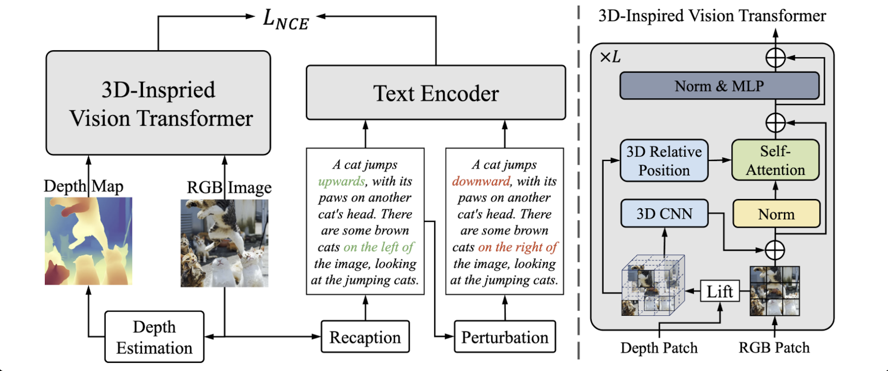

<div align="center">
<h1>SpatialCLIP: Learning 3D-aware Image Representations
from Spatially Discriminative Language</h1>
Zehan Wang<sup>1*</sup>, Sashuai Zhou<sup>1*</sup>, Shaoxuan He<sup>1</sup>, Haifeng Huang<sup>1</sup>,  
Lihe Yang<sup>2</sup>, Ziang Zhang<sup>1</sup>, Xize Cheng<sup>1</sup>, Shengpeng Ji<sup>1</sup>, Tao Jin<sup>1</sup>,  
Hengshuang Zhao<sup>2</sup>, Zhou Zhao<sup>1</sup>
<br><br>

<sup>1</sup>Zhejiang University &emsp;&emsp; <sup>2</sup>The University of Hong Kong  
<sup>*</sup> equal contribution &emsp;

<a href="https://openaccess.thecvf.com/content/CVPR2025/papers/Wang_SpatialCLIP_Learning_3D-aware_Image_Representations_from_Spatially_Discriminative_Language_CVPR_2025_paper.pdf"></a>
<a href='https://github.com/SpatialVision/Spatial-CLIP'></a>
</div>


This repository introduces Spatial-CLIP, a research-oriented, open-source framework that injects spatial understanding into vision-language modeling by building on top of Depth-Anything-V2. It enables more precise associations between textual queries and spatial regions in images, unlocking enhanced describe-and-reason capabilities for scenes with depth and geometry.



## Quick Start

Follow these steps to set up Spatial-CLIP locally and prepare the required checkpoints.

1) Clone the repository and enter the project directory
```bash
git clone https://github.com/master-chou/spatial-clip.git
cd spatial-clip
```

2) Create and activate a Python environment
```bash
conda create -n spclip python=3.10 -y
conda activate spclip
```

3) Install dependencies
```bash
pip install --upgrade pip
pip install -r requirements.txt
```

4) Download and prepare checkpoints

- Download the **Depth-Anything-V2** weights from [Depth-Anything-V2](https://github.com/DepthAnything/Depth-Anything-V2) and place them at:  
/Depth-Anything-V2/checkpoints/depth\_anything\_v2\_vitl.pth

- If other weights are required (e.g., for specific experiments), place them in their designated paths.

> Note: The links above point to the necessary Depth-Anything-V2 checkpoints. Please follow the original repository’s guidance to download and place them in the specified paths to ensure proper model initialization.

5) Run and validate
- The repository already provides the relevant test code in the `evaluate` module.  
For a quick start, you can directly run the provided script:  

```bash
bash evaluation.sh
```


## Quick Demo

The following minimal example shows how to quickly verify **Spatial-CLIP** with one image and one caption.  
It loads the pretrained **Depth-Anything-V2** and **Spatial-CLIP** models, then computes the similarity score.

```python
import torch
from PIL import Image
from torchvision import transforms
from huggingface_hub import hf_hub_download

import spat_clip as sclip
from depth_anything_v2.dpt import DepthAnythingV2

# ----- Load Models -----
device = "cuda" if torch.cuda.is_available() else "cpu"

# Load DepthAnythingV2
depth_model = DepthAnythingV2(encoder="vitl", features=256,
                              out_channels=[256, 512, 1024, 1024])
depth_model.load_state_dict(torch.load(
    "../Depth-Anything-V2/checkpoints/depth_anything_v2_vitl.pth",
    map_location="cpu"
))
depth_model = depth_model.to(device).eval()

# Load Spatial-CLIP
clip_model, _ = sclip.load("ViT-L/14@336px", device="cpu", lora_adapt=False, rank=-1)
ckpt_path = hf_hub_download(repo_id="demo911/spatialclip", repo_type="dataset", filename="iter_5000.pth")
ckpt = torch.load(ckpt_path, map_location="cpu")
clip_model.load_state_dict({k.replace("module.", ""): v for k, v in ckpt.items()}, strict=True)
clip_model = clip_model.to(device).eval()

# ----- Preprocessing -----
preprocess = transforms.Compose([
    transforms.Resize(336, interpolation=transforms.InterpolationMode.BICUBIC),
    transforms.CenterCrop(336),
    transforms.Lambda(lambda image: image.convert("RGB")),
    transforms.ToTensor(),
    transforms.Normalize((0.48145466, 0.4578275, 0.40821073),
                         (0.26862954, 0.26130258, 0.27577711)),
])

# ----- Demo Input -----
image = Image.open("demo.jpg")
caption = "A dog is running on the grass."

image_tensor = preprocess(image).unsqueeze(0).to(device)
depth_map = depth_model(image_tensor)

text_tokens = sclip.tokenize([caption]).to(device)

# ----- Feature Extraction -----
with torch.no_grad():
    image_feat = clip_model.visual(image_tensor, depth_map, pos_embed="")
    text_feat = clip_model.encode_text(text_tokens)

# Normalize
image_feat = image_feat / image_feat.norm(dim=-1, keepdim=True)
text_feat = text_feat / text_feat.norm(dim=-1, keepdim=True)

# ----- Similarity -----
similarity = (image_feat @ text_feat.T).item()
print(f"Similarity between image and caption: {similarity:.4f}")

```


## License

This project is licensed under the Apache-2.0 License.See the LICENSE file for details.

## Acknowledgments

We acknowledge the contributors and the broader open-source community whose work enabled Spatial-CLIP, including:

- [AlphaCLIP](https://github.com/SunzeY/AlphaCLIP)
- [Depth-Anything-V2](https://github.com/DepthAnything/Depth-Anything-V2)
- [LLaVA](https://github.com/haotian-liu/LLaVA)
---

## Citations

If you find Spatial-CLIP useful, please consider citing when publishing work that builds on it. 


```bibtex
@inproceedings{wang2025spatialclip,
  title={SpatialCLIP: Learning 3D-aware Image Representations from Spatially Discriminative Language},
  author={Wang, Zehan and Zhou, Sashuai and He, Shaoxuan and Huang, Haifeng and Yang, Lihe and Zhang, Ziang and Cheng, Xize and Ji, Shengpeng and Jin, Tao and Zhao, Hengshuang and others},
  booktitle={Proceedings of the Computer Vision and Pattern Recognition Conference},
  pages={29656--29666},
  year={2025}
}
```
